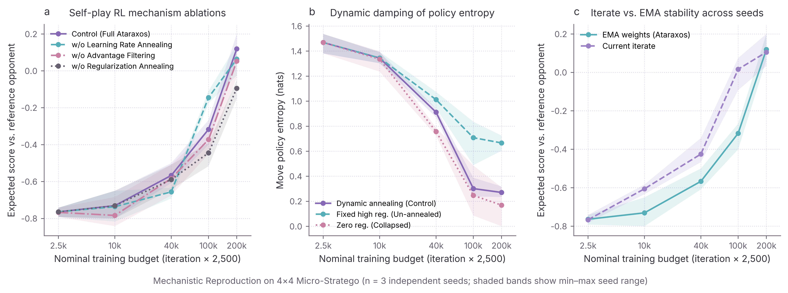
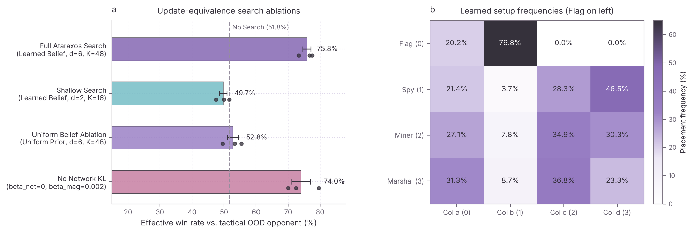

# micro-ataraxos: mechanistic reproduction of scalable decision-making for imperfect information

A single-GPU mechanistic study of **Ataraxos**, the system introduced by Sokota et al. in *Nature* (2026), in a scaled **4×4 Micro-Stratego** environment. The original paper is titled [“Scalable decision-making for games of imperfect information”](https://doi.org/10.1038/s41586-026-11036-y).

The paper reports that its full-scale Stratego reinforcement-learning run used 16 NVIDIA H100 GPUs for one week and comprised 163 million finished games and 208 billion environment steps. Belief-network training was a separate run using four H100 GPUs for four days. This project does not attempt to match that compute scale; instead, it implements and studies selected algorithmic mechanisms in a deliberately reduced environment.

The environment uses a 4×4 board with four pieces per player: `Flag`, `Spy`, `Miner`, and `Marshal`. The implementation retains the interdependent setup and move-learning phases, dynamically damped self-play reinforcement learning, autoregressive hidden-state belief modelling, and test-time update-equivalence search.

**The goal is mechanistic fidelity, not scale replication.** The smaller environment makes the learning and search mechanisms easier to inspect, test, and ablate. No 16-GPU cluster required.

---

## Mechanistic Fidelity and Documented Simplifications

The implementation follows the paper's core design while making explicit reductions to the environment and computational setup. The table distinguishes reproduced mechanisms from changes in scale and implementation.

| Component | Paper specification | Implementation | Fidelity and scope |
|---|---|---|---|
| **Interdependent self-play** | Decoder-only setup Transformer trained with Monte Carlo returns, coupled with an encoder-only move Transformer trained with λ-returns | `SetupNetwork` and `MoveNetwork` in `src/networks.py` and `src/rl.py` | Core architecture reproduced at reduced scale |
| **Spatial move parameterization** | Key-query bilinear product for computing spatial action logits | `torch.bmm(Q, K.transpose(1, 2)) * scale` | Parameterization reproduced |
| **Advantage magnitude filtering** | Retain moves with sufficiently large estimated advantage magnitudes | Top-50% quantile filter on absolute estimated advantages in `src/rl.py` | Mechanism implemented with an explicit threshold |
| **Dynamic damping and update control** | Annealed regularization, reverse-KL update control, importance-ratio clipping, gradient-norm clipping, and a power-law move-network learning-rate schedule | `get_damping_schedules` and the update losses in `src/rl.py` | Core mechanisms implemented with reduced-scale schedules and coefficients |
| **Autoregressive belief network** | Encoder, hidden-token filtering, and row-major autoregressive decoder | `BeliefNetwork._filter_hidden_tokens` and inventory-conservation masking | Core architecture reproduced at reduced scale |
| **Test-time search** | Depth-limited rollouts over sampled belief worlds, followed by a tabular magnetic mirror-descent update | `ataraxos_search_action` in `src/search.py` | Search mechanism implemented with reduced game complexity |
| **Environment and horizon** | 10×10 board, 40 pieces per player, and the original movement, chasing, and game-length rules | 4×4 board, four pieces per player, two-square rule, and 24-move draw limit | Deliberate scale reduction |

### Spatial move parameterization

The move network computes action logits using a scaled key-query bilinear product.

The mathematical operation is:

```text
Logits(i -> j) = dot(Q_i, K_j) / sqrt(d)

Q = W_Q X
K = W_K X
```

The corresponding PyTorch operation is:

```python
torch.bmm(Q, K.transpose(1, 2)) * scale
```

Here, `Q` and `K` are the query and key representations, respectively, and `scale` implements the inverse-square-root scaling.

---

## Experimental Questions

The reproduction focuses on five mechanism-level questions:

1. Does update-equivalence search improve play against a tactically distinct opponent?
2. How do the shallower, lower-rollout search configuration and the uniform-belief ablation compare with full search?
3. How do advantage filtering, learning-rate annealing, and regularization affect self-play learning?
4. How does policy entropy evolve under different regularization configurations?
5. How do the current policy iterate and EMA weights differ during training?

The experiments investigate these mechanisms in a reduced environment. They are not intended to estimate full-scale Stratego performance.

---

## Results

The current experimental suite includes three independent training seeds, multiple training checkpoints, search ablations, and belief-model evaluation.

The figures below are generated from the recorded experimental results. Training curves use nominal training-budget labels derived from recorded training iterations (`iteration × 2,500`). These labels are bookkeeping values, not verified counts of actual environment interactions.

### 1. Self-play learning and regularization



The experiments compare the full training configuration against variants without learning-rate annealing, advantage filtering, or regularization annealing. A separate zero-regularization condition examines policy behaviour when regularization is removed.

The results show differences in learning curves, final expected scores, and policy entropy across these configurations.

At the final checkpoint, iteration 80, the reported mean EMA expected scores against the reference opponent are:

| Configuration | Mean expected score | Mean move entropy |
|---|---:|---:|
| Full configuration (reduced-scale) | +0.119 | 0.271 |
| Without advantage filtering | +0.053 | 0.265 |
| Without learning-rate annealing | +0.064 | 0.230 |
| Without regularization annealing | -0.094 | 0.667 |
| Zero regularization | -0.056 | 0.169 |

These results are consistent with the full configuration performing best on the reported mean expected score in this environment.

The two regularization ablations are distinct experiments and should not be interpreted interchangeably.

### 2. Test-time update-equivalence search



The search experiments compare the following conditions. Evaluation is against an engineered tactical out-of-distribution (OOD) opponent that combines a trained move policy with tactical heuristics; it is not a human-opponent evaluation.

- **Full search:** learned belief model, depth 6, 48 rollout worlds.
- **Shallow search:** learned belief model, depth 2, 16 rollout worlds.
- **Uniform belief:** full search depth and rollout count with a uniform belief prior.
- **No network KL:** full search with the network-reference KL coefficient removed.
- **Raw policy baseline:** the policy network without test-time search.

Across three independent seeds, full search achieves a mean effective win rate of **75.8%**, compared with **51.8%** for the raw-policy baseline.

Shallow search achieves 49.7%, while the uniform-belief condition achieves 52.8%.

Removing network KL achieves 74.0%, close to the full-search result.

The current results suggest that full search substantially improves performance over the raw-policy baseline in this environment. They also suggest that the learned belief model and search configuration matter, although the relative contributions of individual mechanisms require careful interpretation.

In particular, the small difference between full search and the no-network-KL condition does not establish that network KL is necessary for strong search performance in this environment.

### 3. Belief modelling

The learned belief model achieves a mean classification accuracy of **76.4%**, with a mean negative log-likelihood of **0.523** and a mean Brier score of **0.311**.

For comparison, the uniform baseline achieves a negative log-likelihood of **1.386** and a Brier score of **0.750**.

These results provide evidence that the model learns to predict hidden piece identities beyond a uniform prior.

They do not, by themselves, establish generalization to unfamiliar opponent policies. That question depends on the evaluation distribution and the independence of the evaluation data from training. The uniform-baseline comparison also depends on whether its probability assignments respect the same inventory constraints as the learned belief model.

### Experimental protocol

- **Environment:** 4×4 Micro-Stratego.
- **Training checkpoints:** iterations 1, 4, 16, 40, and 80.
- **Nominal training-budget labels:** 2,500 to 200,000 units, computed as `iteration × 2,500`. These labels are bookkeeping values, not verified counts of environment interactions.
- **Independent training seeds:** 42, 43, and 44.
- **Search evaluation:** 120 games per condition per seed.
- **Uncertainty reporting:** observed variation across independent seeds; shaded regions in training plots show the minimum-to-maximum seed range.

Three seeds provide an initial view of run-to-run variability, not a precise estimate of statistical uncertainty. Results are reported as a mechanistic investigation rather than a high-powered statistical comparison.

---

## Repository Structure

```text
micro-ataraxos/
├── README.md
├── requirements.txt
├── paper_style.py
├── run_reproduction.py
├── src/
│   ├── env.py
│   ├── networks.py
│   ├── rl.py
│   ├── search.py
│   └── mechanism_checks.py
└── results/
    ├── rl_ablation_seeds.csv
    ├── search_ablation_seeds.csv
    ├── belief_calibration_seeds.csv
    ├── setup_frequencies.csv  # generated by a full run; optional for plot-only use
    └── figures/
        ├── fig1_ataraxos_mechanisms.png
        └── fig2_search_and_setups.png
```

### Core modules

| File | Purpose |
|---|---|
| `src/env.py` | Vectorized GPU simulator, movement rules, and myopic magnet policy |
| `src/networks.py` | Setup decoder, key-query move encoder, and belief network |
| `src/rl.py` | Damping schedules, return estimation, EMA, and belief training |
| `src/search.py` | Tabular update-equivalence search and evaluation |
| `src/mechanism_checks.py` | Implementation-level invariant and mechanism checks |
| `paper_style.py` | Plotting style, typography, axis formatting, and figure export |
| `run_reproduction.py` | Experiment orchestration, evaluation, CSV export, and figure generation |

---

## Reproducing the Experiments

The main entry point is `run_reproduction.py`.

The experiment runner executes mechanism checks, trains the self-play agents, evaluates the ablations, exports the results as CSV files, and generates the figures.

### Installation

Clone the repository:

```bash
git clone https://github.com/aiyu221b3/micro-ataraxos.git
cd micro-ataraxos
```

Install the dependencies:

```bash
pip install -r requirements.txt
```

Run the experiment suite:

```bash
python run_reproduction.py
```

The experiment runner writes per-seed result CSVs under `results/`, generates `results/setup_frequencies.csv`, and saves the figures under `results/figures/`. To regenerate figures from saved results without retraining, run:

```bash
python -c "from run_reproduction import plot_results; plot_results()"
```

This plot-only path reads the existing RL and search CSVs. For the setup-frequency heatmap, it reads `results/setup_frequencies.csv` when present and otherwise uses the built-in fallback values. A full run recomputes the heatmap from the newly trained control models.

**Reproducibility note:** the figures and reported results correspond to the recorded experimental runs. Reproducing them from scratch requires running the relevant experiments; the presence of a figure alone does not imply that all underlying training checkpoints or intermediate artifacts are included.

---

## Limitations

This is a reduced-scale mechanistic study, not a full-scale reproduction of Ataraxos.

The smaller board, reduced piece inventory, shorter horizon, network configuration, and limited training budget change the strategic environment and computational demands. Consequently, the results should be interpreted as evidence about the implemented mechanisms within Micro-Stratego, not as estimates of full-scale Stratego performance.

The experiments use three independent seeds. Their observed variability is reported descriptively and should not be interpreted as a precise estimate of population uncertainty.

The nominal training-budget labels are not verified interaction counts. The current results therefore do not support claims about sample efficiency measured in actual environment interactions.

The implementation aims to preserve the structure of the paper's core mechanisms while making the system computationally accessible and experimentally inspectable. Architectural similarity alone does not establish exact equivalence of every training objective, update equation, or search detail.

The project is intended to make these mechanisms easier to study, test, and ablate, and to document which conclusions hold in a deliberately reduced environment.

---

## Reference

Sokota, S. et al. (2026). “Scalable decision-making for games of imperfect information.” *Nature*.

https://doi.org/10.1038/s41586-026-11036-y

This repository is an independent implementation and mechanistic study of the published method. Please cite the original paper when referring to Ataraxos itself.
